# RescueNest

> **AI-Powered Emergency Response for Faster, Smarter Rescue Coordination**

[](https://fastapi.tiangolo.com)
[](https://nextjs.org)
[](https://python.org)
[](https://ai.google.dev)
[](https://www.typescriptlang.org)
[](https://pytest.org)

RescueNest is a full-stack, AI-assisted emergency incident reporting, triage, and rescue coordination platform designed for disaster response operations. When communications degrade and dispatch centers are overwhelmed with unstructured reports, RescueNest provides citizens with accessible bilingual emergency reporting (including voice-to-text), evaluates urgency through deterministic triage and Google Gemini agentic reasoning, proposes optimized resource allocations, and maintains an offline-resilient edge gateway for zero-connectivity environments.

> [!IMPORTANT]
> **Safety and Simulation Guardrail:** RescueNest is an operational prototype and coordination simulator. It **never** executes automated real-world dispatch. Every resource allocation requires explicit human operator review and approval, and all approval responses explicitly return `"real_world_dispatch": false`.

---

## Table of Contents

- [1. Project Overview](#1-project-overview)
- [2. Problem Statement](#2-problem-statement)
- [3. Proposed Solution](#3-proposed-solution)
- [4. Key Features](#4-key-features)
- [5. System Architecture](#5-system-architecture)
- [6. Technology Stack](#6-technology-stack)
- [7. Setup and Installation](#7-setup-and-installation)
- [8. AI Methodology and Implementation](#8-ai-methodology-and-implementation)
- [9. AI Models and API Usage](#9-ai-models-and-api-usage)
- [10. API Reference](#10-api-reference)
- [11. Product Screenshots](#11-product-screenshots)
- [12. Individual Contribution](#12-individual-contribution)
- [13. Current Status and Limitations](#13-current-status-and-limitations)
- [14. Testing and Verification](#14-testing-and-verification)
- [15. Future Roadmap](#15-future-roadmap)
- [16. License and Disclaimer](#16-license-and-disclaimer)

---

## 1. Project Overview

During severe emergencies—such as urban flash floods, structural collapses, and industrial hazards—traditional emergency dispatch centers face three acute failure modes:

1. **Intake Saturation:** Citizens in distress submit unstructured, frantic descriptions across languages and communication barriers.
2. **Triage Bottlenecks:** Human operators struggle to rapidly parse priority, medical needs, and proximity when thousands of calls arrive simultaneously.
3. **Connectivity Fragility:** Centralized systems fail entirely when mobile data networks or ISP backbones collapse in disaster zones.

**RescueNest** bridges the gap between citizens in distress and emergency coordination commanders. The platform couples a citizen-facing SOS portal with an operator management console, powered by a dual-tier triage architecture: a **deterministic rule-based triage engine** for guaranteed instantaneous classification, paired with a **Google Gemini tool-using AI Agent** for contextual reasoning and resource matching. An independent **Edge Gateway** caches emergency packets locally in persistent storage and synchronizes them idempotently once upstream connectivity returns.

---

## 2. Problem Statement

Modern disaster response coordination faces significant operational hurdles:

* **Unstructured and Fragmented Reporting:** Distress calls often lack clean structure, containing colloquial expressions, urgent regional dialects, or critical missing details that delay dispatch decisions.
* **Complex Multi-Constraint Matching:** Matching the correct rescue unit requires balancing resource specialization (e.g., extrication gear vs. trauma medical vs. evacuation boats), remaining team capacity, and geographic distance calculated across dynamic road networks.
* **Single Point of Connectivity Failure:** Conventional cloud-only incident dispatch platforms become inaccessible precisely when disasters destroy communications infrastructure, stranding citizens without a way to queue distress requests.
* **Hallucination Risk in Emergency AI:** Free-form LLM outputs can hallucinate nonexistent resource IDs or invent critical details, which is unacceptable in life-or-death decision environments.

---

## 3. Proposed Solution

RescueNest addresses these challenges with a disciplined, human-centered architecture:

```
┌────────────────────────────────────────────────────────────────────────┐
│                              RESCUENEST                                │
├──────────────────────────┬─────────────────────────────────────────────┤
│ CITIZEN LAYER            │ OPERATOR & RESCUE COORDINATION              │
│ • Speech-to-Text Intake  │ • Deterministic Triage (U1–U4)              │
│ • Urdu/English Support   │ • Multi-Factor Priority Scoring (0–100)     │
│ • Landmark / GPS Geo     │ • Strands Gemini Agent (5 Tools, Typed Out) │
│ • Offline Edge SOS Queue │ • Human Approval Gate (Zero Auto-Dispatch)  │
│                          │ • Context-Snapshot Adaptive Replanning      │
└──────────────────────────┴─────────────────────────────────────────────┘
```

* **Resilient Dual-Pipeline Ingestion:** Incidents can be submitted directly to the central cloud API or ingested via a standalone local Edge Gateway running on port `8001`.
* **Deterministic Triage First:** Triage urgency (U1 Immediate to U4 Low) is computed by pure, deterministic rule-based algorithms with negation handling and verifiable evidence lexicons. The system never relies on an LLM just to understand basic priority.
* **Agentic Contextual Enrichment:** A Strands-based Google Gemini Agent calls internal tools to query database state, assess responder availability, measure Haversine distances, and return strictly typed Pydantic models.
* **Mandatory Human-in-the-Loop:** AI proposals remain in an `awaiting_approval` state until an authorized human operator formally reviews the rationale and issues an approval.
* **Adaptive Replanning:** When conditions shift—such as a blocked transport corridor or resource reassignment—RescueNest diffs the incident snapshot against current reality and alerts the operator with an updated proposal.

---

## 4. Key Features

### Citizen Portal & Intake (`/help`)
* **Bilingual Interface:** Supports instant switching between English and Urdu.
* **Voice-to-Text Reporting:** In-browser SpeechRecognition with deterministic keyword extraction that maps natural language descriptions to emergency categories (Medical, Fire, Flood/Water, Structural, Shelter).
* **SSR-Hydration Resilient:** Client-side speech synthesis and audio APIs mount gracefully without server-side hydration mismatches.
* **Precise Geospatial Anchoring:** Captures GPS coordinates alongside local landmark references (e.g., North Nazimabad, Saddar, Clifton).

### Operator Incident Management (`/`)
* **Live Operations Dashboard:** Real-time counters for active incidents, pending reviews, dispatched teams, and resolved operations.
* **Scored Priority Queue:** Dynamic 0–100 priority score derived from severity weights, affected population, elapsed wait time, and urgency labels (`critical`, `high`, `medium`, `low`).
* **Interactive Emergency Map:** Leaflet/CARTO basemap displaying incident severity markers, responder teams, and road corridor status.

### AI Agent Analysis & Verification (`/incidents/[id]`)
* **Multi-Step Tool-Using Agent:** The agent uses five discrete backend tools (`get_incident`, `list_active_incidents`, `find_available_resources`, `get_resource_status`, and `calculate_distance`) before making recommendations.
* **Guaranteed Schema Integrity:** Outputs conform to the `AgentRecommendation` Pydantic model via Strands' `structured_output_model`—eliminating JSON parsing failures and hallucinated fields.
* **Transient Error Resilience:** Automatically handles transient Gemini API HTTP 503 (high demand) and 429 (burst rate limit) errors with bounded exponential backoff retries.
* **Transparent Reasoning Trace:** Operators can inspect the agent's exact decision steps, distance metrics, and capability match logic.

### Adaptive Replanning & Audit Trail (`/plans`)
* **Context Snapshots:** Response plans snapshot active road networks and responder availability at the time of creation.
* **Replan Triggers:** When a road corridor closes (`PATCH /api/routes/{id}`) or an assigned resource becomes unavailable, the system flags the plan as compromised and proposes a versioned replacement (`RPL-000001` v2).
* **Immutable Audit Trail:** Append-only SQLite event log recording timestamps, actors, decisions, and rationale.

### Resilient Edge Gateway (`edge/`, Port `8001`)
* **Local Offline Queue:** Stores SOS packets in a dedicated SQLite database (`edge_queue.db`) when central connectivity is severed.
* **Process Persistence:** Queued packets survive gateway process restarts.
* **Idempotent Cloud Sync:** Packets carry a unique `packet_id`. Running synchronization multiple times guarantees no duplicate incidents are created on the central backend.
* **Bounded Exponential Backoff:** Automatic retries scale from 2s to 60s across 5 attempts.

---

## 5. System Architecture

### High-Level Architecture Flowchart

```mermaid
flowchart TD
    subgraph Citizens["Citizen Intake"]
        C1["Web Browser / SOS Portal\n(:3000/help)"]
        C2["Offline Disaster Zone\n(No Internet)"]
    end

    subgraph Edge["Edge Gateway (:8001)"]
        E1["Edge FastAPI Server"]
        E2[("edge_queue.db\nSQLite")]
        E3["Idempotent Sync Engine"]
    end

    subgraph Central["Central Backend (:8000)"]
        B1["FastAPI Core Router"]
        B2["Deterministic Triage\n& Priority Engine"]
        B3["Adaptive Replanner\n& Route Monitor"]
        B4[("rescunet.db\nSQLite")]
        B5[("resources.db\nSQLite")]
    end

    subgraph AI["AI Layer"]
        A1["Strands Agent"]
        A2["Google Gemini 2.5 Flash\n(Configurable via .env)"]
        A3["Agent Tools\n(Haversine, Inventory, Status)"]
    end

    subgraph Operator["Operator Console (:3000)"]
        O1["Live Map & Priority Queue"]
        O2["Human Approval Gate\n(Approve / Reject)"]
    end

    C1 -->|"POST /api/incidents"| B1
    C2 -->|"POST /edge/incidents"| E1
    E1 --> E2
    E2 --> E3
    E3 -->|"POST /edge/sync\n(Idempotent via packet_id)"| B1

    B1 --> B2
    B1 --> B3
    B1 --> B4
    B1 --> B5

    B1 -->|"Invoke Agent"| A1
    A1 <-->|"Tool Calls"| A3
    A3 <--> B1
    A1 <-->|"Prompt & Schema"| A2

    B1 <-->|"WebSocket / REST"| O1
    O1 -->|"POST /api/agent/approve/{id}"| O2
    O2 -->|"Update Status: dispatched\nresource: deployed"| B1
```



### Incident Lifecycle State Machine

```
   [queued]  ─── Ingested via Central API or Edge Sync
      │
      ▼
 [processing] ─── Deterministic Triage & AI Agent Analysis
      │
      ▼
[awaiting_approval] ─── Recommendation Ready (Human Review Required)
      │
      ├─── Operator Approves ──► [dispatched] ──► [resolved]
      │                               │
      └─── Operator Rejects           └── Road Closes / Resource Redeployed
           or Incident Cancelled                      │
                                                      ▼
                                            [replan_triggered]
                                                      │
                                                      ▼
                                            [revised_proposal]
```

---

## 6. Technology Stack

### Frontend Application
* **Framework:** [Next.js 16.3.3](https://nextjs.org/) (React 19, App Router architecture)
* **Language:** TypeScript 5
* **Styling:** Tailwind CSS v4, Lucide React icons, Framer Motion
* **Geospatial & Mapping:** Leaflet 1.9.4, React-Leaflet 5.0.0, CARTO Vector/Raster Basemap Tiles
* **Speech Integration:** Web Speech API (`webkitSpeechRecognition` & `speechSynthesis`)

### Backend Core API
* **Framework:** [FastAPI](https://fastapi.tiangolo.com/) (0.115+)
* **ASGI Server:** Uvicorn (standard worker setup)
* **Language:** Python 3.13+
* **Validation & Schemas:** Pydantic v2
* **Database & Persistence:** SQLite3 (WAL journal mode, foreign key enforcement)
* **HTTP Client:** HTTPX (0.28+)
* **Environment Management:** python-dotenv (explicit path resolution with override)

### AI & Agent Integration
* **Agent Framework:** [Strands Agents](https://github.com/strands-agents) (`strands-agents 1.54.0`)
* **LLM Provider:** Google Gemini API via official `google-genai` SDK (2.20.0)
* **Configured Model:** `gemini-2.5-flash` (verified active, supports function calling & native JSON schema outputs)

### Edge Gateway Service
* **Framework:** FastAPI, SQLite3, HTTPX
* **Architecture:** Standalone service running on port `8001`, durable queue surviving process termination

---

## 7. Setup and Installation

### Prerequisites
* **Operating System:** Windows 10/11 (PowerShell instructions provided), macOS, or Linux
* **Python:** Python 3.13 or higher installed
* **Node.js:** Node.js 20.x or higher and npm
* **Google Gemini API Key:** Obtainable from [Google AI Studio](https://aistudio.google.com/app/apikey)

---

### Step 1: Clone or Open the Repository

Open a Windows PowerShell terminal:

```powershell
# Navigate to the workspace directory
cd "D:\governer course\hackhathons\Aws"
```

---

### Step 2: Configure Environment Variables

Create your local configuration files from the provided templates:

#### Backend (`backend/.env`):
Create `backend/.env` (a template is provided at [`backend/.env.example`](file:///D:/governer%20course/hackhathons/Aws/backend/.env.example)):

```ini
# Google Gemini API key (Required for AI agent triage & recommendation)
GOOGLE_API_KEY=your-actual-gemini-api-key-here
GEMINI_API_KEY=your-actual-gemini-api-key-here

# Verified Gemini Flash Model ID
GEMINI_MODEL_ID=gemini-2.5-flash

# Backend URL for internal tool calls
BACKEND_URL=http://127.0.0.1:8000
EDGE_PORT=8001

# CARTO Basemap token (Optional)
NEXT_PUBLIC_CARTO_API_KEY=your-carto-key
```

> [!NOTE]
> `backend/agent/config.py` loads `backend/.env` with `override=True`, ensuring values in your local `.env` file take precedence over any stale system or terminal environment variables.

#### Frontend (`frontend/.env.local`):
Create `frontend/.env.local` (template at [`frontend/.env.example`](file:///D:/governer%20course/hackhathons/Aws/frontend/.env.example)):

```ini
NEXT_PUBLIC_BACKEND_URL=http://127.0.0.1:8000
NEXT_PUBLIC_EDGE_URL=http://127.0.0.1:8001
NEXT_PUBLIC_CARTO_API_KEY=your-carto-key
```

---

### Step 3: Run the Services (3 Terminals)

RescueNest operates across three distinct local ports:

| Service | Port | Directory | Command |
| :--- | :--- | :--- | :--- |
| **Backend API** | `8000` | `backend/` | `uvicorn app.main:app --reload --port 8000` |
| **Edge Gateway** | `8001` | `edge/` | `uvicorn app.main:app --reload --port 8001` |
| **Frontend Web** | `3000` | `frontend/` | `npm run dev` |

#### Terminal 1 — Backend API (`:8000`):
```powershell
cd "D:\governer course\hackhathons\Aws\backend"
python -m venv .venv
.\.venv\Scripts\Activate.ps1
pip install -r requirements.txt
uvicorn app.main:app --reload --host 127.0.0.1 --port 8000
```
*Health Check:* Open `http://127.0.0.1:8000/health` or Swagger docs at `http://127.0.0.1:8000/docs`.

#### Terminal 2 — Edge Gateway (`:8001`):
```powershell
cd "D:\governer course\hackhathons\Aws\edge"
python -m venv .venv
.\.venv\Scripts\Activate.ps1
pip install -r requirements.txt
uvicorn app.main:app --reload --host 127.0.0.1 --port 8001
```
*Health Check:* Open `http://127.0.0.1:8001/health` or Swagger docs at `http://127.0.0.1:8001/docs`.

#### Terminal 3 — Frontend Web Console (`:3000`):
```powershell
cd "D:\governer course\hackhathons\Aws\frontend"
npm install
npm run dev
```
*Access Platform:* Open `http://localhost:3000` in your browser.
*Citizen Portal:* Open `http://localhost:3000/help`.

---

## 8. AI Methodology and Implementation

RescueNest follows a strict **Safety-First AI Architecture**. The LLM is never placed in an unconstrained loop and cannot trigger database mutations directly.

```
Incoming Incident Request (RSN-000001)
                │
                ▼
┌──────────────────────────────────────────────┐
│  Stage 1: Deterministic Triage Engine        │
│  • Pure Python rule-based classifier         │
│  • Evidence lexicon matching & negation checks│
│  • Computes U1–U4 Urgency & Priority Score   │
└──────────────────────┬───────────────────────┘
                       │
                       ▼
┌──────────────────────────────────────────────┐
│  Stage 2: Strands Gemini Agent               │
│  • Calls get_incident(id)                    │
│  • Calls find_available_resources(type)      │
│  • Calls calculate_distance(coords)          │
│  • Validates team equipment & capacities     │
└──────────────────────┬───────────────────────┘
                       │
                       ▼
┌──────────────────────────────────────────────┐
│  Stage 3: Pydantic Structured Output         │
│  • AgentRecommendation schema validation     │
│  • Enforces non-hallucinated resource IDs    │
│  • Sets human_approval_required = True       │
└──────────────────────┬───────────────────────┘
                       │
                       ▼
┌──────────────────────────────────────────────┐
│  Stage 4: Human Review & Decision            │
│  • Operator reviews recommendation in UI     │
│  • Approves / Rejects / Modifies             │
│  • Immutable Audit Log Recorded              │
└──────────────────────────────────────────────┘
```

### Agent Tool Definitions
The agent is equipped with five Python tools in [`backend/agent/tools/incident_tools.py`](file:///D:/governer%20course/hackhathons/Aws/backend/agent/tools/incident_tools.py):
1. `get_incident(incident_id)`: Fetches verified incident details, affected people, and coordinates.
2. `list_active_incidents()`: Examines concurrent system load to avoid over-allocating teams.
3. `find_available_resources(incident_type)`: Queries `resources.db` for units matching the required capability whose status is currently `'available'`.
4. `get_resource_status(resource_id)`: Validates real-time deployment status.
5. `calculate_distance(lat1, lon1, lat2, lon2)`: Calculates great-circle Haversine distance in kilometers.

### Resilient Error Handling & Quota Awareness
If Google Gemini encounters rate limits or service outages, RescueNest does not crash:
* **Bounded Retries:** Exponential backoff (max 2 retries; 1.0s, 2.0s) catches transient HTTP 503 high-demand spikes.
* **Quota Exhaustion Handling:** Long-term project quota limits (HTTP 429) fail fast without consuming quota or hanging the client.
* **Graceful Degradation:** When the AI model is unavailable, the platform returns a structured HTTP 503 or 429 error and falls back to deterministic rule-based prioritization, ensuring critical incident data is never lost or corrupted.

---

## 9. AI Models and API Usage

* **Active Model ID:** `gemini-2.5-flash`
* **Configuration Parameter:** `GEMINI_MODEL_ID` in `backend/.env`
* **Provider SDK:** `google-genai` (2.20.0) via `strands-agents` (1.54.0)

### Model Selection Rationale
During integration testing across available Google Gemini endpoints:
* Older endpoints like `gemini-1.5-flash` return HTTP 404 (`NOT_FOUND`) on recent v1beta endpoints.
* Preview configurations like `gemini-3.8-flash` frequently experience severe demand spikes (HTTP 503 `UNAVAILABLE`) and 5 RPM free-tier caps.
* `gemini-2.5-flash` provides the optimal balance of sub-second reasoning speed, full native tool-calling capabilities, structured Pydantic output support, and high request availability.

### Rate Limits and Production Considerations
Free-tier Gemini API keys are subject to strict per-minute (RPM) and per-day (RPD) quotas. In the event of quota exhaustion, the backend logs the exact quota violation and returns a clear, structured response rather than an opaque HTTP 500 error.

---

## 10. API Reference

### Central Backend API (`http://127.0.0.1:8000`)

| Method | Endpoint | Description |
| :--- | :--- | :--- |
| `GET` | `/health` | Service health status check |
| `POST` | `/api/incidents` | Create an emergency incident (idempotent via `packet_id`) |
| `GET` | `/api/incidents` | List all incidents ordered newest first |
| `GET` | `/api/incidents/{id}` | Retrieve incident details by ID (`RSN-XXXXXX`) |
| `PATCH`| `/api/incidents/{id}/status` | Update incident status (`queued`, `dispatched`, `resolved`) |
| `GET` | `/api/incidents/priority-queue`| Retrieve priority-ranked incident queue with scoring factors |
| `POST` | `/api/agent/analyze/{id}` | Run agentic multi-tool AI analysis on incident |
| `POST` | `/api/agent/analyze-priority/{id}`| Extract structured priority factors via AI |
| `GET` | `/api/agent/recommendation/{id}`| Retrieve cached enriched recommendation |
| `POST` | `/api/agent/approve/{id}` | **Approve recommendation & mark resource deployed** |
| `GET` | `/api/resources` | Query real-time responder and resource inventory |
| `GET` | `/api/plans` | List active adaptive rescue plans and proposals |
| `POST` | `/api/plans/{id}/approve` | Approve a revised rescue plan proposal |
| `GET` | `/api/routes` | List road network corridors with open/closed status |
| `PATCH`| `/api/routes/{id}` | Toggle route corridor status (triggers replanning check) |
| `GET` | `/api/incidents/{id}/audit` | Retrieve immutable audit trail for an incident |

### Edge Gateway API (`http://127.0.0.1:8001`)

| Method | Endpoint | Description |
| :--- | :--- | :--- |
| `GET` | `/health` | Gateway health check |
| `POST` | `/edge/incidents` | Ingest local SOS packet to local SQLite storage |
| `GET` | `/edge/queue` | View local queue status (`queued`, `synced`, `failed`) |
| `GET` | `/edge/connectivity` | Query current edge connectivity mode (`ONLINE` / `OFFLINE`) |
| `POST` | `/edge/connectivity` | Toggle edge connectivity mode |
| `POST` | `/edge/sync` | Trigger batch idempotent sync of queued packets to central backend |
| `GET` | `/edge/status` | Gateway diagnostics and central backend reachability check |

---

## 11. Product Screenshots

Screenshots should be placed in the [`docs/screenshots/`](file:///D:/governer%20course/hackhathons/Aws/docs/screenshots/README.md) directory.

### Interface Views

| View | Route | Caption | Status |
| :--- | :--- | :--- | :--- |
| **Citizen SOS Intake** | `/help` | Bilingual emergency reporting portal with voice-to-text and automatic category inference. | [`docs/screenshots/01-citizen-sos-intake.png`](file:///D:/governer%20course/hackhathons/Aws/docs/screenshots/01-citizen-sos-intake.png) |
| **Operator Dashboard** | `/` | Emergency operations overview featuring live incident metrics and dynamic priority queue. | [`docs/screenshots/02-admin-dashboard.png`](file:///D:/governer%20course/hackhathons/Aws/docs/screenshots/02-admin-dashboard.png) |
| **AI Analysis & Dispatch** | `/incidents/[id]` | Multi-tool Gemini reasoning trace, distance calculation, and human approval workflow. | [`docs/screenshots/03-incident-detail-ai-analysis.png`](file:///D:/governer%20course/hackhathons/Aws/docs/screenshots/03-incident-detail-ai-analysis.png) |
| **Geographic Coordination Map** | `/` | Leaflet/CARTO basemap displaying live incident markers and responder team coordinates. | [`docs/screenshots/04-live-coordination-map.png`](file:///D:/governer%20course/hackhathons/Aws/docs/screenshots/04-live-coordination-map.png) |
| **Adaptive Rescue Plans** | `/plans` | Versioned rescue proposal diffing interface highlighting road obstruction triggers. | [`docs/screenshots/05-adaptive-rescue-plans.png`](file:///D:/governer%20course/hackhathons/Aws/docs/screenshots/05-adaptive-rescue-plans.png) |
| **Resource Inventory** | `/resources` | Live inventory of rescue assets with equipment tags, capacity, and deployed badges. | [`docs/screenshots/06-resource-inventory.png`](file:///D:/governer%20course/hackhathons/Aws/docs/screenshots/06-resource-inventory.png) |
| **Edge Gateway Synchronization** | Operator Console | Offline packet storage and idempotent upstream synchronization monitor. | [`docs/screenshots/07-edge-gateway-sync.png`](file:///D:/governer%20course/hackhathons/Aws/docs/screenshots/07-edge-gateway-sync.png) |

---

## 12. Individual Contribution

RescueNest is an **individual, solo hackathon project**. All architecture, backend services, frontend engineering, AI integration, and documentation were conceived and executed independently by the author.

### Scope of Individual Implementation:
* **Architecture & Database Design:** Designed the dual-service distributed architecture, SQLite schemas with foreign keys, and persistent edge storage models.
* **Backend Services (`backend/`):** Built 8 core FastAPI domain services (Priority, Triage, Matching, Recommendation, Approval, Plan, Route, Incident) and sequential ID generators.
* **AI Agent Integration (`backend/agent/`):** Configured the Strands Gemini Agent, authored tool implementations, engineered structured Pydantic schemas, and implemented transient retry backoff logic.
* **Edge Gateway (`edge/`):** Developed the offline packet queue, network mode toggling, bounded backoff retry engine, and idempotent sync endpoints.
* **Frontend Web Application (`frontend/`):** Implemented the Next.js 16 App Router interface, Leaflet/CARTO map visualization, SpeechRecognition voice integration, and bilingual translation state.
* **Testing & Quality Assurance:** Created comprehensive test suites comprising 193 backend unit and integration tests and 35 edge gateway test suites.

---

## 13. Current Status and Limitations

### Operational Capabilities
* **Complete End-to-End Pipeline:** Ingesting incidents (web or offline edge) -> deterministic triage -> AI recommendation -> human approval -> resource deployment is fully functional.
* **Live Verified AI Endpoint:** `POST /api/agent/analyze/RSN-XXXXXX` verified returning HTTP 200 with structured Pydantic recommendations.
* **Robust Test Coverage:** 193 backend tests passing cleanly.

### Known Limitations & Hackathon Boundaries
* **AI API Quota Dependency:** Live AI analysis depends on Google Gemini API availability. When rate limits or high demand occur on free-tier keys, the system gracefully reports the condition but cannot complete new LLM analyses until quota resets.
* **Geospatial Model:** Distance calculation uses great-circle Haversine formulas. Real-world elevation, traffic bottlenecks, and detailed road networks require future OSRM integration.
* **Simulation Scope:** Does not perform physical radio broadcasts or real-world emergency service dispatch.

---

## 14. Testing and Verification

### Backend Automated Test Suite
The backend contains 193 comprehensive unit and integration tests covering API routes, triage logic, matching algorithms, priority scoring, approval invariants, and resource reset routines.

```powershell
cd "D:\governer course\hackhathons\Aws\backend"
.\.venv\Scripts\Activate.ps1
pytest -v
```

**Verified Test Results:**
```
======================= 193 passed in 15.00s =======================
```

| Test Module | Coverage Scope |
| :--- | :--- |
| `tests/test_agent.py` | Haversine math, resource DB, Strands tool calls, structured Pydantic output |
| `tests/test_api.py` | Incident CRUD, sequential ID validation, status transitions |
| `tests/test_approval.py` | Human approval gate, idempotency, stale recommendation rejection (409) |
| `tests/test_citizen_intake.py` | Citizen emergency intake, landmark resolution, category parsing |
| `tests/test_dispatch_lifecycle.py` | Complete dispatch invariant tests from creation to resolution |
| `tests/test_matching.py` | Equipment constraints, capacity checks, distance ranking |
| `tests/test_plans.py` | Versioned rescue plans, context snapshots, replanning triggers |
| `tests/test_priority.py` | Deterministic priority formula, multi-factor weighting |
| `tests/test_resource_reset.py` | Safe testing reset routines and transactional safety |
| `tests/test_triage.py` | Rule-based U1–U4 urgency criteria, negation handling |

### Edge Gateway Test Suite
```powershell
cd "D:\governer course\hackhathons\Aws\edge"
.\.venv\Scripts\Activate.ps1
pytest -v
```
**Coverage:** 35 automated tests verifying queue persistence, idempotency, connectivity toggles, and retry backoff.

### Frontend Type Verification
```powershell
cd "D:\governer course\hackhathons\Aws\frontend"
npx tsc --noEmit
```
**Coverage:** Zero TypeScript compilation errors across all Next.js pages and components.

---

## 15. Future Roadmap

* **Physical Mesh Networking:** Integrate real LoRa / Meshtastic packet radios via serial or Bluetooth interface to the Edge Gateway for physical off-grid text transmission.
* **Turn-by-Turn Routing Engine:** Connect an open-source OSRM (Open Source Routing Machine) or Valhalla container for turn-by-turn road navigation and bridge height constraints.
* **Field Responder Mobile Application:** Progressive Web App (PWA) allowing deployed rescue teams to mark arrival, report on-scene triage updates, and request secondary supplies.
* **Multi-Agency Federation:** Role-based access control (RBAC) separating municipal fire, health departments, and volunteer civilian rescue groups into distinct federated dashboards.

---

## 16. License and Disclaimer

### License
This project is currently provided as a private prototype developed for hackathon evaluation and demonstration purposes. No commercial or open-source license is granted at this time (All Rights Reserved).

### Disclaimer
> [!CAUTION]
> **Emergency Medical & Dispatch Disclaimer:** RescueNest is an experimental software prototype developed solely for educational, hackathon, and research demonstration purposes. It is **NOT** a certified 911/emergency dispatch platform, does not connect to public emergency service networks, and must **never** be relied upon as a substitute for professional emergency response, search-and-rescue coordination, or licensed medical triage.
